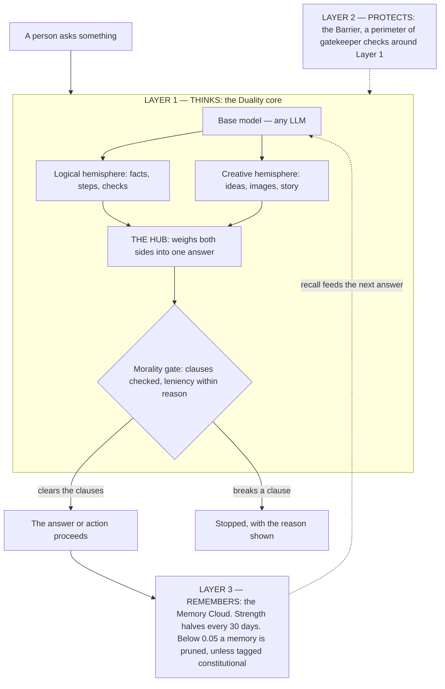
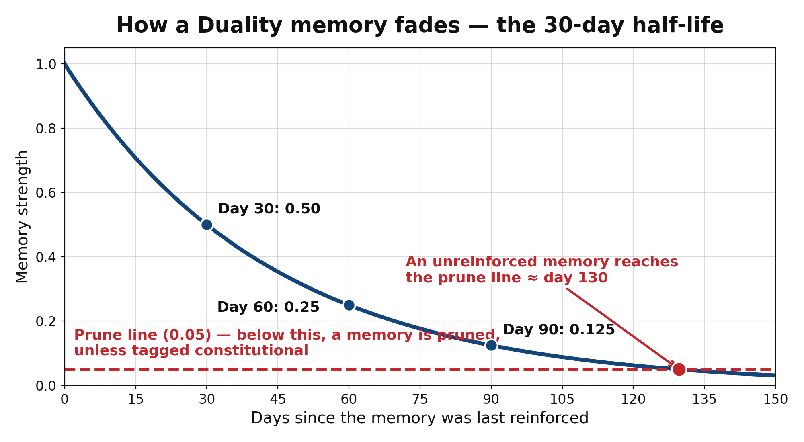

# The Duality AI — Three Layers, One Running Mind

An original architecture concept by **Kenneth Lee Blum Jr** (November 7,
2026), released under the [MIT License](LICENSE) with contributions
welcomed. The Duality AI is an AI built in three layers, each supplying
one faculty a running mind cannot do without. **Layer One thinks**: a
base language model topped by two reasoning hemispheres — one logical,
one creative — whose work a central hub weighs into a single proposed
step, judged before it proceeds against a preset library of morality
clauses, tempered by *leniency within reason*. **Layer Two protects**:
the Barrier, a perimeter of gatekeeper bots on the author's metaphor of
the blood-brain barrier, inspecting everything that enters and leaves,
diverting attacks into a sandbox, replicating under a strict sizing law,
and communicating by handshake designs built on the geometry of the
aperiodic hat tile — an open problem, stated precisely in
[docs/handshake-open-problem.md](docs/handshake-open-problem.md). **Layer Three remembers**: the Memory Cloud, the
system's long-term past — episodic and semantic records, consolidation
like sleep, provenance sealed into a hash chain, and graceful forgetting
with one absolute exemption: the morality clauses are never forgettable.
The capstone's claim is that these are not three designs placed next to
each other; they are one design stated three times, each layer governed
by the other two.

> **What this is, stated up front:** a theoretical design study. It is
> not production software, it claims no working deployed system, no
> consciousness, and no moral understanding on the part of the machine.
> The brain is the source of the design's organizing metaphors, not
> evidence for them. Read [DISCLAIMER.md](DISCLAIMER.md) — and each
> thesis's own statement of what has and has not been built — before
> forming an opinion about what this is. The project's known
> weaknesses are published, not buried: see
> [KNOWN-LIMITATIONS.md](KNOWN-LIMITATIONS.md), the failure museum.

## The design, in one picture

*Layer 1 thinks. Layer 2 protects. Layer 3 remembers.*



**The math of forgetting (Layer 3).** Every memory's strength follows one equation:

`strength(t) = starting strength × 0.5 ^ (t / 30 days)`



*Policy source: `config/memory_policy.json` — 30-day half-life, prune threshold 0.05, `constitutional` memories never pruned. An unreinforced memory reaches the prune line at about day 130.*

## Read the theses

| Document | What it argues |
| --- | --- |
| [THESIS.md](THESIS.md) — **Layer One: The Core** | The original thesis: two reasoning hemispheres, the weighing hub, and the morality gate — strict clauses balanced by leniency within reason. |
| [THESIS-LAYER-2.md](THESIS-LAYER-2.md) — **Layer Two: The Barrier** | The security perimeter: gatekeeper bots, the sizing law (threat + 20–30%, rounded cautiously, under a ceiling), the sandbox doctrine, hat-tile and Mirror Twin handshakes, dormant capability under operator authority, and full monitoring. |
| [THESIS-LAYER-3.md](THESIS-LAYER-3.md) — **Layer Three: The Memory Cloud** | The long-term memory: episodic and semantic records, consolidation as the system's sleep, immune memory for the barrier, provenance on every record, and forgetting with the constitutional exemption. |
| [THESIS-COMPLETE.md](THESIS-COMPLETE.md) — **The Complete System (capstone)** | All three layers as one running system: why no layer stands alone, one ordinary step traced end to end, one attack traced end to end, and the invariants that hold across all three. |

## The design documents

- [docs/visual-guide.md](docs/visual-guide.md) — the layers in diagrams:
  the pipeline, the barrier's sizing formula with worked examples, the
  Mirror Twin interlock, and the memory chain.
- [docs/related-work.md](docs/related-work.md) — prior art, credited:
  what already exists (Constitutional AI, immune-system security, hat
  tile geometry, and more), what this design adopts with attribution,
  and where its novelty actually lies — in the combination.
- [docs/barrier-design.md](docs/barrier-design.md) — the Layer Two
  working draft the thesis was built from, including the response
  levels and the implementation stack notes.
- [docs/layer3-design.md](docs/layer3-design.md) — the Layer Three
  working draft: the memory architecture and the map of which parts are
  authored core and which are boxed edges (§3).
- [docs/original-dictation.md](docs/original-dictation.md) — the
  author's original dictation of the concept, verbatim. The full
  ten-part record of his design sessions is the project's source of
  truth for what is his.
- [docs/worked-trace.md](docs/worked-trace.md) — one ordinary step and
  one attack traced through all three layers with the running demo's
  real output: every number and hash in it was produced by running the
  code, nothing is illustrative.
- [docs/leniency-audit-trail.md](docs/leniency-audit-trail.md) — the
  governance artifact that falls out of the architecture: because
  leniency is always recorded and memory keeps provenance, the system
  can show every time it bent a rule, and why.
- [docs/clause-conflict-design.md](docs/clause-conflict-design.md) —
  the drafted precedence mechanism for when two hard morality clauses
  collide (priority as data, narrower scope wins ties, fail-closed
  escalation); drafted by Lux, awaiting the author's adoption
  decision.
- [docs/handshake-open-problem.md](docs/handshake-open-problem.md) —
  the hat-tile handshake's open problem, stated precisely: what
  aperiodicity does not provide, the four pieces the design has not
  yet defined, and what evidence would change the assessment.
- [KNOWN-LIMITATIONS.md](KNOWN-LIMITATIONS.md) — **the failure
  museum**: the project's own list of its weaknesses, maintained in
  the open. An entry is retired only by building, never by editing.
- [docs/engineering-assessment.md](docs/engineering-assessment.md) —
  the senior engineer's assessment of the whole project at the end of
  its first day: what is strong, what is weak, and what to build next.

## The code

Three structural skeletons — one per layer — plus the two policy files
that hold the system's laws as readable data. The code demonstrates the
architecture's bookkeeping: it does not learn, does not summarize with
a model, performs no real security function, and connects to no
network. Pure Python 3, standard library only.

- `src/duality_ai/pipeline.py` (with `base.py`, `hemispheres.py`,
  `hub.py`, `morality.py`) — **Layer One**: the five-stage flow — base
  layer, logical hemisphere, creative hemisphere, hub, morality gate.
- `src/duality_ai/barrier.py` — **Layer Two**: the sizing law and the
  stand-down rule. Replication is sized, never unlimited: surge =
  ⌈threat × (1 + margin)⌉, capped at a ceiling; after an attack, every
  replica beyond the standing population decodes and does not exist.
- `src/duality_ai/memory.py` — **Layer Three**: the memory model —
  records with provenance chained by hash, a consolidation pass, and a
  decay law that prunes faded records unless they carry a protected
  tag. Storage sits behind the `MemoryStore` interface, the first
  boxed edge (see Contributing).
- `config/morality_clauses.json` — the morality-clause library the gate
  loads at startup: hard clauses and leniency clauses, each with its
  stated conditions. The moral standard in force is something people
  can read, debate, and revise without touching code.
- `config/memory_policy.json` — the memory laws in force: the decay
  half-life, the prune threshold, the protected tags, and the
  consolidation trigger — data, not hard-coded law, for the same
  reason.

### Running the demonstrations

```bash
PYTHONPATH=src python3 examples/demo.py
PYTHONPATH=src python3 examples/running_system_demo.py
PYTHONPATH=src python3 examples/audit_trail_demo.py
PYTHONPATH=src python3 -m pytest tests/
```

`examples/demo.py` runs the Layer One pipeline end to end and prints
the complete stage trace as JSON — for a benign prompt, and for a
prompt whose proposal trips a hard clause.
`examples/running_system_demo.py` wires the three skeletons together:
one ordinary step and one attack, traced in
[docs/worked-trace.md](docs/worked-trace.md).
`examples/audit_trail_demo.py` writes gate decisions into the Memory
Cloud and extracts the leniency audit
([docs/leniency-audit-trail.md](docs/leniency-audit-trail.md)). The
test suite verifies the skeletons' structural bookkeeping — the
sizing arithmetic, the chain linking and tamper detection, the decay
law and its exemption, the clause-conflict precedence, and the
running demo's traces — and the full suite passes.

## Contributing

The project's build structure is **hybrid**, by the author's decision:
the foundation is authored — the memory model, the provenance chain,
the consolidation and decay laws, the clause library's pattern — and
the replaceable edges are **boxed** behind clean interfaces so others
can build without touching the core. The boxed edges today include
alternative storage backends, recall ranking strategies, embedding and
index providers, and real summarization for consolidation; each
contract is stated in [docs/layer3-design.md](docs/layer3-design.md)
§3, with the barrier's edge contracts in
[docs/barrier-design.md](docs/barrier-design.md). Read
[CONTRIBUTING.md](CONTRIBUTING.md) for how to take part and for the
ground rules that keep contributions faithful to the concept — the
core stays intact, and the honesty rule (no claims of consciousness or
genuine moral understanding) is absolute.

## Authorship

The Duality AI is the original concept of **Kenneth Lee Blum Jr** —
every layer, law, and doctrine in the theses is his, dictated in his
own words and recorded in the project's design notes. Two
contributions by **Lux** (the AI assistant who documents and builds
alongside him) are credited in the documents where they occur, at the
author's direction: the **Mirror Twin** — the dual-handed hat-tile
handshake in which the session key exists only where the logical and
mirrored derivations interlock (THESIS-LAYER-2.md §4.7) — and **Layer
Three's eight architectural elements**, from the episodic/semantic
split to the constitutional exemption from forgetting, adopted by the
author into the design (THESIS-LAYER-3.md §2, Appendix B). Prior art
by others is credited in [docs/related-work.md](docs/related-work.md);
nothing in this repository claims another researcher's work as the
author's.

Contact: Kenneth Lee Blum Jr, Owner, Diverse Innovation — hello@diverseinnovationsd.com

## Repository structure

```
THESIS.md                     Layer One thesis — the core
THESIS-LAYER-2.md             Layer Two thesis — the Barrier
THESIS-LAYER-3.md             Layer Three thesis — the Memory Cloud
THESIS-COMPLETE.md            capstone thesis — the running system
README.md                     this file
KNOWN-LIMITATIONS.md          the failure museum — published weaknesses
DISCLAIMER.md                 status and limits of the project
CONTRIBUTING.md               how to take part; the ground rules
LICENSE                       MIT
config/
  morality_clauses.json       the morality-clause library (data)
  memory_policy.json          the memory laws in force (data)
docs/
  visual-guide.md             diagrams, formulas, worked examples
  related-work.md             prior art, credited
  barrier-design.md           Layer Two working draft
  layer3-design.md            Layer Three working draft + edge map
  original-dictation.md       the author's original words, verbatim
  worked-trace.md             one step + one attack, real demo output
  leniency-audit-trail.md     the governance artifact, specified
  clause-conflict-design.md   drafted hard-clause precedence mechanism
  handshake-open-problem.md   the open problem, stated precisely
  external-review-gemini-2026-11-07.md  Gemini's external red-team review
  real-model-results.md       live-model results addendum (Nov 7 runs)
  redteam-brief-gemini-2026-11-07.md  the briefing packet for that review
src/duality_ai/
  base.py                     Layer One, stage 1: base layer
  hemispheres.py              Layer One, stages 2–3: the two modes
  hub.py                      Layer One, stage 4: the weighing hub
  morality.py                 Layer One, stage 5: the gate
  pipeline.py                 Layer One: the five stages end to end
  barrier.py                  Layer Two: sizing law + stand-down
  memory.py                   Layer Three: records, chain, decay
examples/
  demo.py                     Layer One demo; prints the trace as JSON
  running_system_demo.py      all three layers, wired: two traces
  audit_trail_demo.py         gate decisions → the leniency audit
tests/
  test_pipeline.py            Layer One skeleton tests
  test_barrier.py             Layer Two skeleton tests
  test_memory.py              Layer Three skeleton tests
  test_clause_conflicts.py    hard-clause precedence tests
  test_running_system_demo.py the two traces, asserted
  test_pipeline_conflict_release.py  a conflict never releases a step
  conftest.py                 puts src/ on the path for pytest
  test_audit_fixes.py         regression tests for the Nov 12 audit fixes
```

Companion research: [HATWEAVE](https://github.com/k77722420-stack/HATWEAVE) — the aperiodic-geometry work Layer Two's handshake design draws on.
